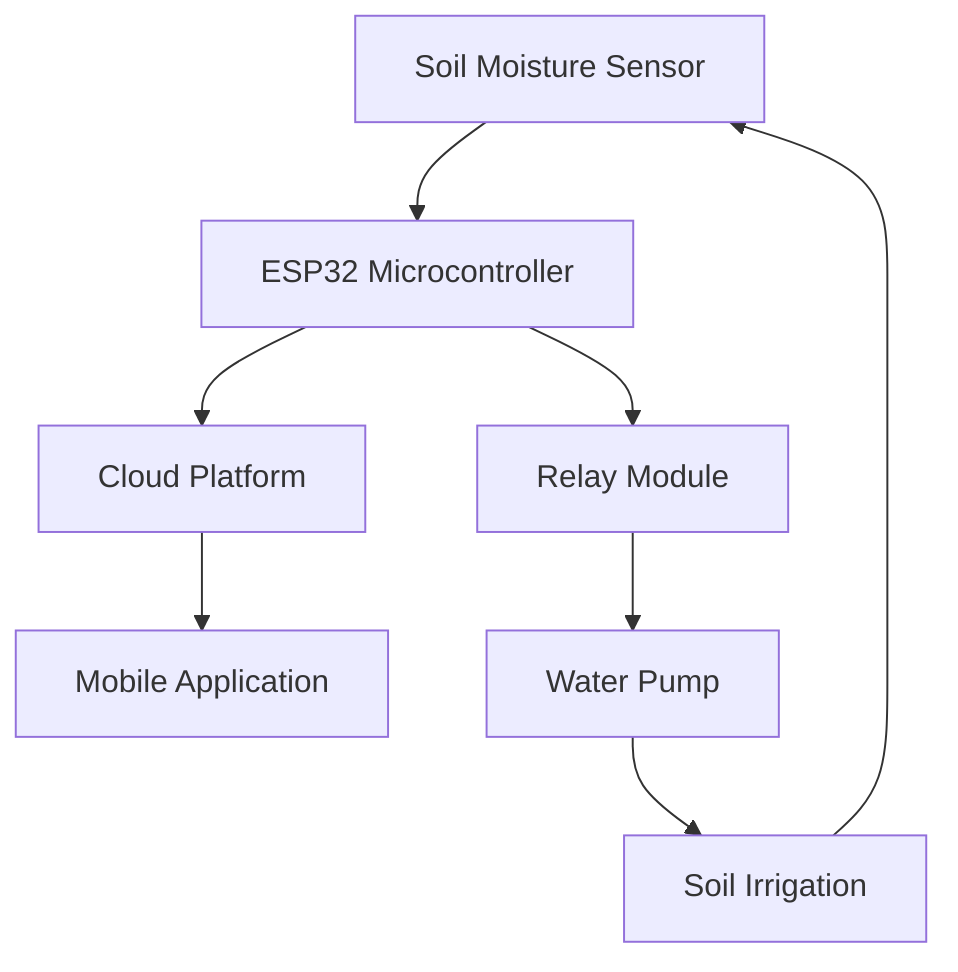

# EX.NO.4 – EXPERIMENT 4
## Generate and Evaluate Prompts for Different Prompt Patterns

**DATE:** 05-11-2026

**REGISTER NUMBER:** 212225040306

---

## Aim

To design prompts using different prompt engineering patterns, including Zero-shot Prompting, Few-shot Prompting, Chain of Thought, Persona Pattern, Reverse Prompting, Graph Prompting, and Active Prompting, and compare their responses using different AI tools with a suitable evaluation method.

## Prompt Patterns Used

1. Zero-shot Prompting
2. Few-shot Prompting
3. Chain of Thought
4. Persona Pattern
5. Reverse Prompting
6. Graph Prompting
7. Active Prompting

---

## Explanation

Prompt Engineering is the process of designing and improving instructions given to Artificial Intelligence models to obtain relevant, accurate, and useful responses.

Different prompt patterns help users communicate their requirements effectively and guide AI models to generate responses according to specific tasks.

In this experiment, seven prompt engineering patterns are applied to an IoT-based Smart Agriculture System. The prompts are tested using ChatGPT, Google Gemini, and Microsoft Copilot, and their responses are evaluated using a rubric-based evaluation method.

---

# Procedure

## 1. Define the Scenario and Use Case

### Scenario: IoT-Based Smart Agriculture System

Agriculture is one of the most important sectors, but farmers face several challenges such as water scarcity, unpredictable weather, soil quality problems, and difficulty in monitoring crops.

An IoT-based Smart Agriculture System uses sensors, embedded controllers, and internet connectivity to monitor agricultural conditions and automate certain farming activities.

The system collects information from the agricultural field and helps farmers make better decisions regarding irrigation, soil monitoring, and crop maintenance.

### Target Audience

- Farmers
- Agricultural researchers
- Agricultural technology companies
- Irrigation management professionals
- Students and researchers working with IoT

### Main Objectives

- Monitor soil moisture levels in real time.
- Automate irrigation based on soil conditions.
- Reduce unnecessary water consumption.
- Monitor temperature and humidity.
- Improve crop growth and productivity.
- Provide real-time information to farmers.

### Technologies Used

| Technology | Purpose |
|---|---|
| IoT Sensors | Collect soil and environmental data |
| Soil Moisture Sensor | Measure water content in soil |
| Temperature Sensor | Monitor temperature |
| Humidity Sensor | Measure humidity levels |
| Arduino / ESP32 | Process sensor information |
| Water Pump | Automatically supply water |
| Internet Connectivity | Send data to monitoring applications |

---

## 2. Identify Prompt Patterns for Each Design Aspect

# 1. Zero-shot Prompting

### Definition

Zero-shot Prompting is a technique in which an AI model is given a task directly without providing any examples. The model generates a response based on its existing knowledge and understanding of the instructions.

### Prompt

"Explain how an IoT-based smart irrigation system works. Describe the role of soil moisture sensors, microcontrollers, and water pumps. Also explain how this system helps farmers save water and improve crop growth. Use simple English."

### Expected Output

An IoT-based smart irrigation system uses sensors and connected devices to monitor soil conditions and automatically control irrigation.

**Working Process:**

1. Soil moisture sensors measure the water content in the soil.
2. The sensor sends the collected data to a microcontroller.
3. The microcontroller checks whether the soil moisture is below the required level.
4. If the soil is dry, the water pump is activated automatically.
5. Once sufficient moisture is reached, the pump is switched off.

This system reduces manual work, saves water, and helps maintain suitable soil moisture for crop growth.

### Observation

The AI model generates a relevant response without requiring any sample examples. This shows that zero-shot prompting is useful for direct questions and general explanations.

---

# 2. Few-shot Prompting

### Definition

Few-shot Prompting is a technique in which a small number of examples are provided to the AI model before asking it to perform a similar task. These examples help the model understand the expected pattern and format of the response.

### Prompt

"Classify the following agricultural conditions and provide a suitable recommendation.

**Example 1:**

Input: Soil moisture is low.

Output: Activate the irrigation system to supply water.

**Example 2:**

Input: Temperature is very high.

Output: Monitor crop conditions and provide suitable protection against excessive heat.

**Example 3:**

Input: Soil moisture is sufficient.

Output: Keep the water pump switched off to avoid unnecessary water usage.

**Now classify the following conditions:**

1. Soil moisture is low and temperature is normal.
2. Soil moisture is sufficient and temperature is high.
3. Soil moisture is low and humidity is also low.

Provide the output in a table with columns for Input Condition, Classification, and Recommendation."

### Expected Output

| Input Condition | Classification | Recommendation |
|---|---|---|
| Low soil moisture, normal temperature | Dry soil | Activate irrigation |
| Sufficient soil moisture, high temperature | Adequate soil moisture | Keep the pump off and monitor crop heat stress |
| Low soil moisture, low humidity | Dry environmental conditions | Activate irrigation and monitor crop conditions |

### Observation

The examples guide the AI model to follow the expected classification format. Few-shot prompting is useful when a task requires consistent and structured responses.

---

# 3. Chain of Thought Prompting

### Definition

Chain of Thought Prompting encourages an AI model to approach a complex problem through smaller, logical steps before presenting its final answer.

It is useful for solving problems that involve calculations, decisions, or multiple conditions.

### Prompt

"An IoT-based irrigation system uses a soil moisture sensor to control a water pump.

The sensor measures soil moisture as 20%. The minimum required moisture level is 40%.

Explain the decision-making process step by step. Identify whether irrigation is required, explain how the microcontroller makes the decision, and provide the final action of the water pump. Present the key steps and final answer clearly."

### Expected Output

**Step 1 – Read Sensor Data:**

The soil moisture sensor measures the moisture level as 20%.

**Step 2 – Compare Values:**

The measured moisture is 20%, while the minimum required moisture is 40%.

**Step 3 – Identify the Condition:**

Since 20% is less than 40%, the soil does not contain sufficient moisture.

**Step 4 – Make a Decision:**

The microcontroller identifies that irrigation is required.

**Step 5 – Perform the Action:**

The microcontroller activates the water pump to supply water to the field.

**Final Answer:** Irrigation is required because the soil moisture level is below the minimum threshold.

### Observation

Chain of Thought Prompting helps break a problem into smaller steps and makes the decision-making process easier to understand.

---

# 4. Persona Pattern

### Definition

Persona Pattern is a prompting technique in which the AI model is assigned a specific role or identity before performing a task. This helps generate responses from a particular professional or personal perspective.

### Prompt

"Act as an experienced agricultural scientist who specializes in smart farming and IoT technologies.

Explain how an IoT-based smart agriculture system can help farmers improve crop productivity. Discuss soil moisture monitoring, automated irrigation, temperature monitoring, and the benefits of using sensors in agriculture.

Provide practical recommendations using simple English that can be understood by small-scale farmers."

### Expected Output

As an agricultural scientist, I recommend using IoT technology to improve traditional farming methods.

An IoT-based smart agriculture system can help farmers in the following ways:

1. **Soil Monitoring:** Soil moisture sensors help identify when crops need water.
2. **Automated Irrigation:** Water pumps can be controlled automatically based on soil moisture readings.
3. **Temperature Monitoring:** Temperature sensors help farmers monitor environmental conditions.
4. **Water Conservation:** Irrigation is provided only when required, reducing unnecessary water usage.
5. **Better Crop Management:** Continuous monitoring helps farmers identify problems early.

**Recommendation:** Farmers can begin with a basic system using an ESP32, soil moisture sensor, and water pump before expanding to more advanced IoT applications.

### Observation

The persona-based prompt produces a response from the viewpoint of an agricultural expert. It helps generate audience-specific and practical recommendations.

---

# 5. Reverse Prompting

### Definition

Reverse Prompting is a technique in which the AI model is asked to create or reconstruct an effective prompt based on a desired output or objective.

Instead of directly asking AI to solve a problem, the user first describes the expected result and asks AI to formulate a suitable prompt.

### Prompt

"I want to generate a detailed explanation of an IoT-based smart irrigation system suitable for a first-year engineering student.

The explanation should include:

- Introduction to smart irrigation.
- Components required.
- Working principle.
- Role of IoT sensors and microcontrollers.
- Advantages and applications.
- A simple real-world example.

First, create a clear and effective prompt that can generate this explanation. Then use the generated prompt to produce the final explanation."

### Expected Output

**Generated Prompt:**

"Act as an IoT technology instructor. Explain an IoT-based smart irrigation system to a first-year engineering student. Include its introduction, components, working principle, role of sensors and microcontrollers, advantages, applications, and a practical example. Use simple English and organize the answer using headings and bullet points."

**Generated Explanation:**

An IoT-based smart irrigation system is an automated system that monitors soil moisture and controls the water supply according to the needs of crops.

**Components:**
- Soil moisture sensor
- ESP32 or Arduino microcontroller
- Water pump
- Relay module
- Internet connectivity

**Working:**

The soil moisture sensor collects information from the soil and sends it to the microcontroller. The microcontroller processes the data and activates the water pump when the moisture level falls below a predefined threshold.

**Advantages:**
- Saves water.
- Reduces manual work.
- Improves irrigation efficiency.
- Supports better crop management.

### Observation

Reverse Prompting helps users create better instructions when they are unsure how to formulate an effective prompt. It also improves the quality and organization of the final response.

---

# 6. Graph Prompting

### Definition

Graph Prompting is a technique in which information is represented using nodes and relationships (edges). It helps AI understand how different components are connected and how information flows between them.

It is useful for explaining systems, processes, dependencies, and relationships.

### Prompt

"Represent an IoT-based smart irrigation system as a graph. Identify the main components as nodes and explain their relationships using directed connections.

Include the following components:

1. Soil Moisture Sensor
2. ESP32 Microcontroller
3. Cloud Platform
4. Mobile Application
5. Relay Module
6. Water Pump

Show the direction of data flow and control flow. Present the result as a simple directed graph using Mermaid syntax and explain each connection."

### Expected Output

**Graph Representation:**

**Explanation of Connections:**

| Connection | Relationship |
|---|---|
| Sensor → ESP32 | Sends soil moisture readings |
| ESP32 → Cloud | Sends collected data |
| Cloud → Mobile App | Displays monitoring information |
| ESP32 → Relay | Sends pump control signals |
| Relay → Water Pump | Controls pump operation |
| Water Pump → Soil | Supplies water to the soil |

### Observation

Graph Prompting helps represent the relationships between different components of an IoT system. It makes complex system architecture easier to understand through visual representation.

---

# 7. Active Prompting

### Definition

Active Prompting is an interactive prompting technique in which the AI model actively identifies missing information, asks relevant questions, or requests clarification before generating the final response.

This helps improve the accuracy and relevance of the generated output.

### Prompt

"I want to design an IoT-based smart irrigation system for a small agricultural field.

Before suggesting a suitable system design, ask me five important questions about the field size, crop type, water source, budget, and available internet connectivity.

Wait for my answers. Based on the information provided, recommend suitable sensors, a microcontroller, irrigation components, and a simple working procedure."

### Expected Output

The AI model may ask the following questions:

1. What is the total area of the agricultural field?
2. Which type of crop is being cultivated?
3. What is the available water source?
4. What is the approximate budget for the system?
5. Is Wi-Fi or mobile internet connectivity available in the field?

**Example User Responses:**

| Question | Response |
|---|---|
| Field size | 1 acre |
| Crop type | Tomato |
| Water source | Borewell |
| Budget | ₹5,000–₹10,000 |
| Internet | Wi-Fi available |

**Expected Recommendation:**

Based on the provided information, a basic IoT-based irrigation system can use:

- ESP32 microcontroller for processing and connectivity.
- Soil moisture sensors for monitoring soil conditions.
- Relay module for controlling the water pump.
- Water pump for automatic irrigation.
- Mobile application or dashboard for monitoring.

The system can activate irrigation when soil moisture falls below the selected threshold.

### Observation

Active Prompting helps gather additional information before generating a solution. It makes the response more relevant to the user's actual requirements.

---

## 3. Comparison of AI Tools

The seven prompt patterns are tested using the following AI tools:

1. ChatGPT
2. Google Gemini
3. Microsoft Copilot

### Comparison Table

| Prompt Pattern | ChatGPT | Gemini | Copilot |
|---|---|---|---|
| Zero-shot | To be evaluated | To be evaluated | To be evaluated |
| Few-shot | To be evaluated | To be evaluated | To be evaluated |
| Chain of Thought | To be evaluated | To be evaluated | To be evaluated |
| Persona | To be evaluated | To be evaluated | To be evaluated |
| Reverse Prompting | To be evaluated | To be evaluated | To be evaluated |
| Graph Prompting | To be evaluated | To be evaluated | To be evaluated |
| Active Prompting | To be evaluated | To be evaluated | To be evaluated |

*Replace the entries with your observations after testing the same prompts in all three AI tools.*

---

## 4. Evaluation Method – Rubric-Based Evaluation

### Evaluation Criteria

The responses generated by the three AI tools are evaluated using the following criteria.

| Criteria | Description |
|---|---|
| Accuracy | Correctness of the generated information |
| Relevance | How closely the response matches the prompt |
| Clarity | How easily the response can be understood |
| Completeness | Whether all requested points are covered |
| Structure | Organization of the response using headings, lists, or tables |

### Scoring System

| Score | Performance |
|---|---|
| 5 | Excellent |
| 4 | Very Good |
| 3 | Good |
| 2 | Average |
| 1 | Poor |

### Evaluation Results

*Enter the scores based on your actual generated responses.*

| AI Tool | Accuracy | Relevance | Clarity | Completeness | Structure | Total |
|---|---:|---:|---:|---:|---:|---:|
| ChatGPT | __ | __ | __ | __ | __ | __/25 |
| Gemini | __ | __ | __ | __ | __ | __/25 |
| Copilot | __ | __ | __ | __ | __ | __/25 |

### Evaluation Analysis

The rubric-based evaluation helps identify the strengths and weaknesses of different AI-generated responses.

- **Accuracy:** Checks whether the technical information is correct.
- **Relevance:** Checks whether the response follows the given prompt.
- **Clarity:** Evaluates how easily the response can be understood.
- **Completeness:** Checks whether all the requested information is included.
- **Structure:** Evaluates the organization and presentation of the response.

The AI tool with the highest total score can be considered the best-performing tool for the tested prompts.

---

## 5. Overall Observation

The seven prompt engineering patterns demonstrate different ways of interacting with AI models.

| Prompt Pattern | Main Purpose |
|---|---|
| Zero-shot | Generate responses without examples |
| Few-shot | Guide AI using sample examples |
| Chain of Thought | Break complex tasks into logical steps |
| Persona | Generate responses from a specific role |
| Reverse Prompting | Create an effective prompt from a desired output |
| Graph Prompting | Represent relationships between components |
| Active Prompting | Ask questions to collect missing information |

Each prompt pattern has a different purpose and can be selected depending on the task and expected output.

---

## Conclusion

This experiment demonstrates the use of seven different prompt engineering patterns: Zero-shot Prompting, Few-shot Prompting, Chain of Thought, Persona Pattern, Reverse Prompting, Graph Prompting, and Active Prompting.

An IoT-based Smart Agriculture System was selected as the use case to apply these techniques.

The experiment shows that different prompt patterns can guide AI models to generate explanations, follow examples, solve problems step by step, adopt professional roles, create prompts, represent system relationships, and gather additional information through interaction.

The responses generated by ChatGPT, Google Gemini, and Microsoft Copilot can be compared using a rubric-based evaluation method to understand their performance.

Overall, the experiment helps in understanding how effective prompt design improves communication with AI models and produces more relevant and organized outputs.

## Result

The seven prompt engineering patterns were successfully designed and applied to the selected IoT-based Smart Agriculture System use case. Their outputs were compared using different AI tools and evaluated using a rubric-based evaluation method.
